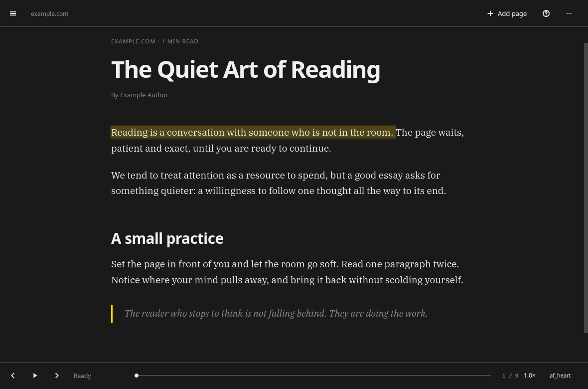

# sift

Read the web, aloud, with Kokoro. A native Omarchy app that strips a page down
to the article, keeps a durable Markdown copy, and reads it sentence by
sentence with a local Kokoro voice.



## What it does

- Loads a public URL in Qt WebEngine and extracts the article with
  [Defuddle](https://github.com/kepano/defuddle), the same extractor used by
  Obsidian Web Clipper.
- Saves a clean Markdown file and a full article snapshot, with resume position.
- Reads aloud through [Kokoro-FastAPI](https://github.com/remsky/Kokoro-FastAPI)
  at `http://127.0.0.1:8880`, with sentence highlighting, prefetch, and a voice
  and speed picker.
- Keeps a single reading queue that advances automatically.
- Follows the Omarchy theme, light/dark mode, window rounding, and language.

## Requirements

- Omarchy with Qt 6 (`qt6-base`, `qt6-declarative`, `qt6-multimedia`,
  `qt6-webengine`, `qt6-wayland`).
- A running Kokoro-FastAPI server. The app connects to it; it does not start it.

```sh
docker run -d --name kokoro -p 8880:8880 ghcr.io/remsky/kokoro-fastapi-cpu:latest
```

The endpoint is configurable in Settings if you use a different host or port.

## Build and install

```sh
./bin/build      # builds build/sift
./bin/test       # Qt Test suite, offscreen
./bin/install    # makepkg -fsi: binary, desktop entry, icon
```

`bin/install` puts `sift` in the Omarchy launcher (`Super + Space`).

## Use

```sh
sift                              # open the app
sift <url>                        # open a page and read it
sift add <url>                    # clip it without opening the window
sift list                         # list saved pages
sift play <id|url>                # open and start reading
sift export <id>                  # Markdown to stdout
sift queue add <id|url>           # queue a previously saved page
```

`add` and `list` support `--json`. The headless `add` command saves a page
without adding it to the queue; use `queue add` with its ID or saved URL to queue it. A running app
refreshes itself after a headless `add`.

## Keyboard

| Key | Action |
|---|---|
| `Space` | Play / pause |
| `[` / `]` | Previous / next sentence |
| `-` / `+` | Slower / faster |
| `V` | Voice picker |
| `A` | Add a page |
| `J` / `K` | Move in the queue, or scroll the article when the queue is hidden |
| `Enter` | Open the selected queue item |
| `E` | Copy the Markdown export |
| `F` | Show / hide the queue |
| `PageUp` / `PageDown` | Scroll the article |
| `?` | All shortcuts |
| `Q` | Quit |

The queue can be reordered or cleared from its menus; removing an item does not
delete its saved files. Clicking any sentence starts reading from there. Manually
scrolling suspends following; choose **Return to playback** to resume it.
`Alt+click` on a link opens
it as a new sift article; a normal click opens it in your browser.

## Where things live

- Saved-page and queue index: `~/.local/share/sift/sift.db`
- Article snapshots: `~/.local/share/sift/articles/<id>/content.html`
- Markdown exports: `~/Documents/sift/<slug>-<hash>.md` (configurable)
- Kokoro audio cache: `~/.cache/sift/audio/` (1 GB cap by default)

Markdown files get YAML frontmatter with `title`, `source`, `author`,
`published`, `clipped`, `domain`, `word_count`, and `tags`. If you edit a
Markdown file outside sift, sift writes the next clip to a new file instead of
overwriting your work.

## How it works

```text
URL → hidden Qt WebEngine → Defuddle → HTML + Markdown + metadata
                                          │
                    SQLite index + Markdown + article snapshot
                                          │
             visible Qt WebEngine reader with sentence spans
                                          │
        Kokoro /v1/audio/speech → MP3 cache → QMediaPlayer
```

`Intl.Segmenter` splits the rendered article into sentences inside the reader;
the C++ engine prefetches the next two through Kokoro and caches each MP3 by
voice, speed, and text. Code blocks and tables are skipped when speaking.

## Limitations

- Public pages only for v1. Logged-in and paywalled pages may fail.
- Anti-bot pages can block Qt WebEngine; the error banner reports the failure.
- Article images stay linked to their source; the HTML snapshot is not a fully
  offline image archive.
- Kokoro audio is cached per sentence, so there is a short gap between
  sentences while playback moves to the next file.
- The app connects to Kokoro but does not manage the Docker container.

## Development

`bin/test` covers theme fallbacks, translation, saved articles and queue
operations. It also launches the real QML and WebEngine reader offscreen with
an isolated temporary home, checks sentence seeking and the queue, and opens
the main dialogs. The GUI test disables the Chromium sandbox for that isolated
test process; the application does not disable it.

The app scaffolding follows Omacut and Monologue (MIT, David Heinemeier
Hansson). Defuddle is MIT, copyright Steph Ango; its license is in
`LICENSES/defuddle.txt`.

## License

MIT. See [LICENSE](LICENSE).
