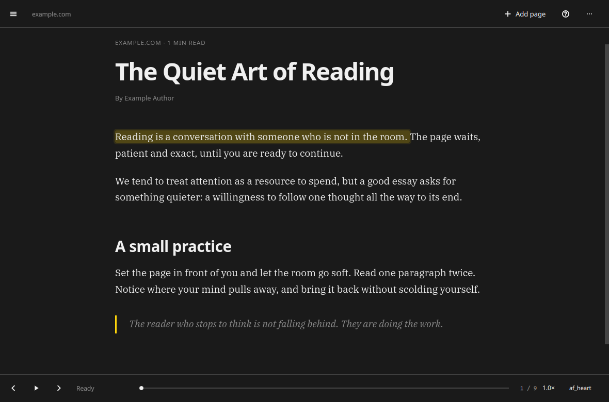

# sift

[](https://aur.archlinux.org/packages/sift-reader)
[](LICENSE)

**Read the web, aloud.** sift strips a web page down to its article, keeps a
clean Markdown copy, and reads it to you sentence by sentence with a local
[Kokoro](https://github.com/remsky/Kokoro-FastAPI) voice. It keeps one reading
queue, remembers where you stopped, and stays out of the way. A native Qt 6 app
for [Omarchy](https://omarchy.org).

<p align="center">
  <a href="docs/demo.mp4">
    
  </a>
  <br>
  <em>Watch the 55-second demo</em>
</p>

## Features

- **Reads the page, not the chrome.** Qt WebEngine loads the URL, then
  [Defuddle](https://github.com/kepano/defuddle) — the same extractor behind
  Obsidian Web Clipper — pulls out the article, title, author, and metadata.
- **Local voices.** Kokoro-FastAPI speaks each sentence. sift highlights the
  sentence it is reading, preloads the next paragraph, and caches audio per
  voice, speed, and text.
- **A real queue.** Add pages from the app or the CLI, let sift advance
  automatically, and reorder by drag, keyboard, or `sift move`.
- **Keeps your place.** Every article is saved as an HTML snapshot plus
  Markdown, with the last sentence remembered, so reopening sift continues
  where you stopped.
- **Yours on disk.** A SQLite index, plain Markdown with YAML frontmatter. No
  account, no sync service, no telemetry.
- **At home on Omarchy.** Follows the Omarchy theme, light/dark preference,
  window rounding, and locale. Pick any installed font for the reading view.



## Requirements

- Arch Linux or Omarchy with Qt 6 (`qt6-base`, `qt6-declarative`,
  `qt6-multimedia`, `qt6-webengine`, `qt6-wayland`). The AUR package installs
  these for you.
- A running [Kokoro-FastAPI](https://github.com/remsky/Kokoro-FastAPI) server.
  sift connects to it; it does not start the container.
- Network access to fetch the pages you want to read.

## Install

### From the AUR

```sh
yay -S sift-reader       # builds from source
yay -S sift-reader-bin   # prebuilt x86_64 binary
```

`sift-reader` compiles on your machine and is available for `x86_64` and
`aarch64`. `sift-reader-bin` is the same program, already built and stripped,
for `x86_64` only; it skips Qt's development packages and the compile. The two
provide and conflict with each other, so pacman will not install both.

The package is called **`sift-reader`**, not `sift`: `sift` on the AUR is an
unrelated grep tool, and a package name can only be used once. The command is
still `sift`. Both packages declare a conflict with `sift`, `sift-bin`, and
`sift-git`, which all ship `/usr/bin/sift`, so pacman will not quietly swap
your reader for the grep tool.

### From source

```sh
sudo pacman -S --needed base-devel qt6-base qt6-declarative qt6-multimedia qt6-webengine qt6-wayland

git clone https://github.com/sarrietav-dev/sift.git
cd sift
./bin/build     # builds build/sift
./bin/install   # makepkg -fsi: binary, desktop entry, icon
```

`bin/install` puts sift in the Omarchy launcher (`Super + Space`). Run
`build/sift` directly if you just want to try it.

### Start Kokoro

```sh
docker run -d --name kokoro --restart unless-stopped -p 8880:8880 ghcr.io/remsky/kokoro-fastapi-cpu:latest
```

`--restart unless-stopped` keeps Kokoro up: Docker starts it again if the
container crashes and after a reboot, as long as Docker itself is enabled.
`docker restart kokoro` reloads it by hand; `docker stop kokoro` takes it down
for good until you `docker start kokoro` again.

sift expects `http://127.0.0.1:8880` by default; point it somewhere else under
**Settings → Kokoro endpoint**. The GPU image,
`ghcr.io/remsky/kokoro-fastapi-gpu:latest`, works too. On a machine with rootful
Docker, run the command with `sudo` and add yourself to Docker's group only if
you accept that it is equivalent to root.

## Usage

```sh
sift                              # open the app
sift <url>                        # open a page and start reading it
sift add <url|id>                 # queue a page, fetching it if it is new (a)
sift list                         # list the queue (ls)
sift list --all|--unread|--reading|--read   # list saved pages instead
sift remove <id|url|n>            # take a page off the queue (rm)
sift move <id|url|n> <n|top|bottom>   # reorder the queue (mv)
sift play <id|url>                # open and start reading
sift export <id|url>              # Markdown to stdout
sift sync export <file>           # write a snapshot for another machine
sift sync merge <file>            # merge another machine's snapshot
```

`add`, `list`, `remove`, and `move` work on the queue and accept `--json`
where they print something. `add` fetches and saves a new URL before queueing
it, or queues a page you have already saved. Queue positions start at 1. A
running app refreshes itself after any of these commands.

### Keyboard

| Key | Action |
|---|---|
| `Space` | Play / pause |
| `[` / `]` | Previous / next sentence |
| `-` / `+` | Slower / faster |
| `V` | Voice picker |
| `A` | Add a page |
| `J` / `K` | Move in the queue, or scroll the article when the queue is hidden |
| `Shift+J` / `Shift+K` | Move the selected queue item down / up |
| `Delete` | Remove the selected queue item |
| `Enter` | Open the selected queue item |
| `E` | Copy the Markdown export |
| `F` | Show / hide the queue |
| `PageUp` / `PageDown` | Scroll the article |
| `?` | All shortcuts |
| `Q` | Quit |

Drag a queue item by its grip (the position number turns into one on hover) to
reorder it, or use its menu to play it next or send it to the top or bottom.
The queue menu can sort the whole list by title, author, or the date each page
was added; sorting replaces the manual order. Removing an item does not delete
its saved files. Clicking any sentence starts reading from there. Manually
scrolling suspends following; choose **Return to playback** to resume it.
`Alt+click` a link to open it as a new sift article; a normal click opens it in
your browser.

### Settings

**⋯ → Settings** covers the Kokoro endpoint, the Markdown folder, the reading
font and text size, playback speed, the audio cache size (1 GB by default),
auto-advance to the next queued page, and the appearance (follow Omarchy,
follow the system light/dark preference, or stay light or dark). Theme changes
crossfade.

## Where things live

- Saved-page and queue index: `~/.local/share/sift/sift.db`
- Article snapshots: `~/.local/share/sift/articles/<id>/content.html`
- Markdown exports: `~/Documents/sift/<slug>-<hash>.md` (configurable)
- Kokoro audio cache: `~/.cache/sift/audio/` (1 GB cap by default)

Markdown files get YAML frontmatter with `title`, `source`, `author`,
`published`, `clipped`, `domain`, `word_count`, and `tags`. If you edit a
Markdown file outside sift, sift writes the next clip to a new file instead of
overwriting your work.

## Syncing between machines

sift has no server and no account. To keep one reading list across machines on
your tailnet, move snapshots and merge them:

```sh
sift sync export ~/sift-snapshots/$(hostname).db   # consistent copy; the app can stay open
sift sync merge ~/sift-snapshots/other-machine.db  # merge another machine's copy
```

Transport is yours: rsync over Tailscale, Taildrop, or Syncthing. A
hub-and-spoke timer works well when one node stays online:

```sh
#!/bin/sh
# every 15 minutes; tailscale ssh must be enabled on the hub
HUB=cloud   # a MagicDNS name for an always-on node
sift sync export "$HOME/.cache/sift/sync/$(hostname).db"
rsync -a "$HOME/.cache/sift/sync/" "HUB:/srv/sift-snapshots/"
rsync -a "HUB:/srv/sift-snapshots/" "$HOME/.cache/sift/sync/"
for snapshot in "$HOME/.cache/sift/sync/"*.db; do
    sift sync merge "$snapshot"
done
```

Merging is safe while the app runs, and the app refreshes itself afterwards.

- Articles match by id, then by canonical URL, so clipping the same page on two
  machines keeps one row. The newer metadata wins.
- Progress follows the latest play. `read` wins over `unread`.
- Tags and playlists are unioned.
- The queue keeps the newer order and appends anything only the other machine
  had.
- Settings stay local, so the Kokoro endpoint and save folder do not travel.
- Deletions do not propagate yet. The other machine's snapshot brings the
  article back.
- Both machines need the same schema version. After upgrading one side, upgrade
  the other before merging; an older snapshot is refused rather than half read.

Article bodies live in `articles/<id>/content.html`. That folder is write-once,
so sync it with the same tool, and leave `sift.db` alone. Never point a file
sync tool at the live database: WAL mode writes it continuously and the copies
will not line up.

## How it works

```text
URL → hidden Qt WebEngine → Defuddle → HTML + Markdown + metadata
                                          │
                    SQLite index + Markdown + article snapshot
                                          │
   one persistent Qt WebEngine reader page; each article renders in place
                                          │
        Kokoro /v1/audio/speech → MP3 cache → QMediaPlayer
```

`Intl.Segmenter` splits the rendered article into sentences inside the reader.
The C++ engine preloads the rest of the current paragraph and the whole next
paragraph through Kokoro, then caches each MP3 by voice, speed, and text. Code
blocks and tables are skipped when speaking.

## Limitations

- Public pages only for now. Logged-in and paywalled pages may fail.
- Anti-bot pages can block Qt WebEngine; the error banner reports the failure.
- Article images stay linked to their source. The HTML snapshot is not a fully
  offline image archive.
- Kokoro audio is cached per sentence, so there can be a short gap between
  sentences while playback moves to the next file.
- The app connects to Kokoro but does not manage the Docker container.

## Development

```sh
./bin/build   # build/sift
./bin/test    # Qt Test suite, offscreen
```

`bin/test` covers theme fallbacks, translation, saved articles, and queue
operations. It also launches the real QML and WebEngine reader offscreen with
an isolated temporary home, checks sentence seeking and the queue, and opens
the main dialogs. The GUI test disables the Chromium sandbox for that isolated
test process; the application does not disable it.

The demo video is a [Remotion](https://www.remotion.dev) project in `video/`:

```sh
cd video
npm i
npm run dev       # preview
npm run render    # renders out/sift.mp4
```

<details>
<summary>Releasing</summary>

Bump `pkgver` (and reset `pkgrel` to 1) in `src/main.cpp`,
`pkgbuild/PKGBUILD`, `pkgbuild/aur/PKGBUILD`, and
`pkgbuild/aur-bin/PKGBUILD`, then tag the release, attach the prebuilt
tarball, and push both AUR packages:

```sh
git tag v0.1.2 && git push origin v0.1.2
./bin/package     # writes dist/sift-0.1.2-x86_64.tar.zst and prints its sha256
gh release create v0.1.2 dist/sift-0.1.2-x86_64.tar.zst --title "sift 0.1.2"
```

Put the printed sha256 in `pkgbuild/aur-bin/PKGBUILD`, and make sure the
release exists before you push it, or the AUR will not be able to fetch it:

```sh
aur_push() { # package-name package-dir
  version=$(sed -n 's/^pkgver=//p' "$2/PKGBUILD")
  (cd "$2" && makepkg --printsrcinfo > .SRCINFO)
  rm -rf "/tmp/$1-aur"
  git clone -q "ssh://aur@aur.archlinux.org/$1.git" "/tmp/$1-aur"
  cp "$2/PKGBUILD" "$2/.SRCINFO" "/tmp/$1-aur/"
  git -C "/tmp/$1-aur" add PKGBUILD .SRCINFO
  git -C "/tmp/$1-aur" commit -m "$1 $version"
  git -C "/tmp/$1-aur" push
}

aur_push sift-reader pkgbuild/aur
aur_push sift-reader-bin pkgbuild/aur-bin
```

The first push creates a package on the AUR. Both PKGBUILDs build or fetch
from the `v$pkgver` tag, so the tag and its release asset must exist first.

</details>

## Contributing

Bug reports and pull requests are welcome. Run `./bin/test` before opening a
pull request, and keep changes focused. There is no formal process or CLA.

## Credits

- Article extraction: [Defuddle](https://github.com/kepano/defuddle) (MIT,
  Steph Ango); its license is in `LICENSES/defuddle.txt`.
- Speech: [Kokoro-FastAPI](https://github.com/remsky/Kokoro-FastAPI).
- The reader's typography follows Obsidian Web Clipper's reader view (MIT,
  Obsidian).
- The app scaffolding follows Omacut and Monologue (MIT, David Heinemeier
  Hansson).

## License

MIT. See [LICENSE](LICENSE).
